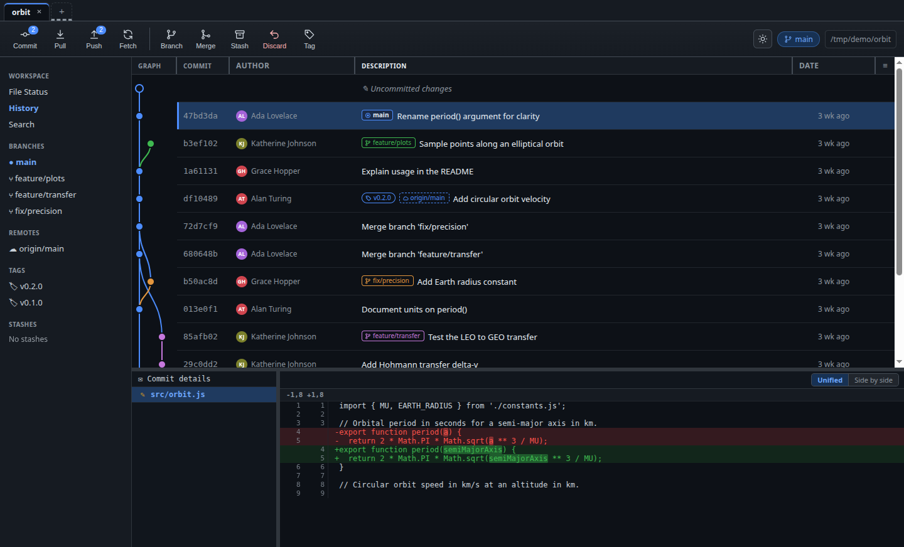

# Treeline

A local desktop git client modeled on SourceTree. Runs entirely on
`127.0.0.1`; shells out to your system `git` (which handles all auth).



## Run

Install once:

```bash
npm install
npm install --prefix server
npm install --prefix web
```

Then either develop or install the app:

```bash
npm run dev      # Electron window on the Vite dev server, with hot reload
npm run deploy   # build the AppImage and install it to ~/.local/bin
```

After `npm run deploy`, launch it as `treeline` from a terminal or from
your desktop app launcher. Re-run `npm run deploy` to upgrade in place.

`scripts/deploy.sh` unpacks the AppImage once into `~/.local/lib/treeline`
(so FUSE 2 isn't needed) and installs a `treeline` launcher plus a desktop
entry. Don't add `--no-sandbox` — the AppImage's own AppRun script adds it
automatically when the kernel requires it.

The app icon (`build/icon.png`) is generated once by `scripts/make-icon.mjs`
and committed; there's no need to run it again unless you want to change the
icon.

Open a repository with the folder picker; each repository gets its own tab.

## Test

```bash
npm test         # runs the server, web, and electron suites
```

## Scope

History graph with search, file status + stage/unstage, diff, commit,
branches, tags, stashes, merge (with conflict resolution), and
fetch/pull/push. A diff's hunks can be staged, unstaged or discarded one at a
time; untracked files have no index entry to patch against, so they stage
whole. Rebase, submodules, and blame are not yet implemented.
